# nixdots

NixOS / home-manager configurations in the
[dendritic pattern](https://github.com/mightyiam/dendritic), on a
dependency-free, hand-rolled substrate.

Every `.nix` file under `modules/` is a module of one top-level configuration.
Lower-level modules are values of that configuration, stored under
`flake.modules.<class>.<aspect>` and merged by name, so a feature is written
once across every class it touches:

```nix
# modules/features/git.nix
root: {
  flake.modules.nixos.git.programs.git.enable = true;
  flake.modules.homeManager.git = { ... };
}
```

## Gallery

The desktop is Hyprland with a [Quickshell](https://quickshell.org) shell
that follows GNOME 51 for the most part: gnome-shell for its surfaces,
libadwaita for what is in them. The notable exceptions are darker surfaces,
numbered square workspaces led by the distro's logo, a system tray, Caffeine
beside Night Light, a launcher (apps, clipboard, windows, nixpkgs) instead of
the overview, a full-screen power menu, and weather in MET Norway's colour
icons; the rest are in
[STYLE.md](./modules/features/hyprland/quickshell/STYLE.md). Screenshots come
from `qs-test`, which runs the shell nested and headless against fake
NetworkManager, BlueZ, UPower and MPRIS services.

| | |
| --- | --- |
| 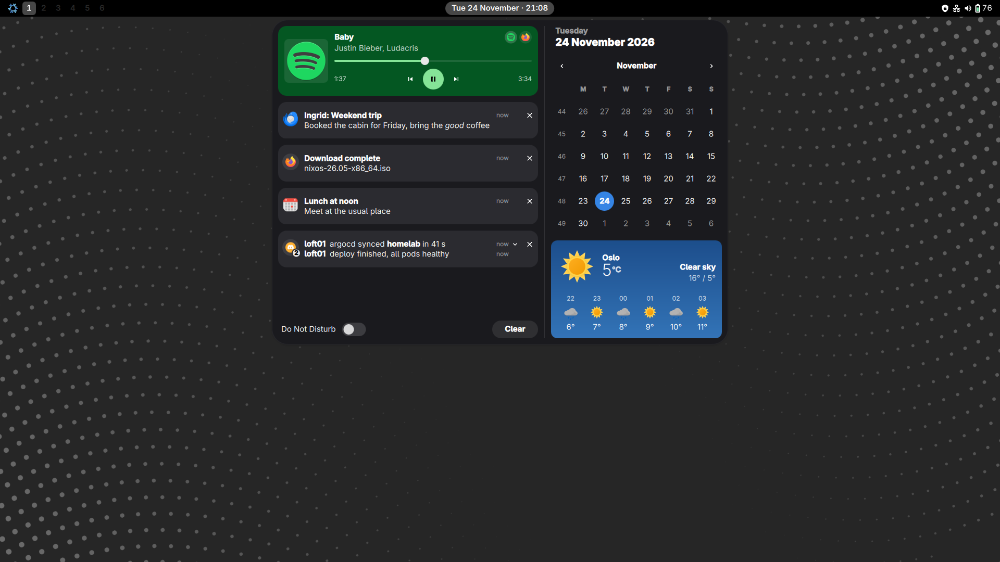 | 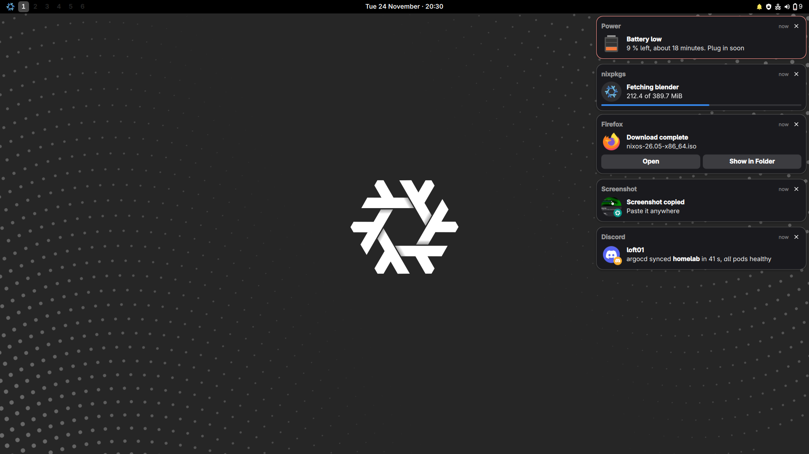 |
| Date menu: player, notifications grouped per app, calendar, MET Norway weather | Notification popups: critical, buttons, progress, pictures, markup |
| 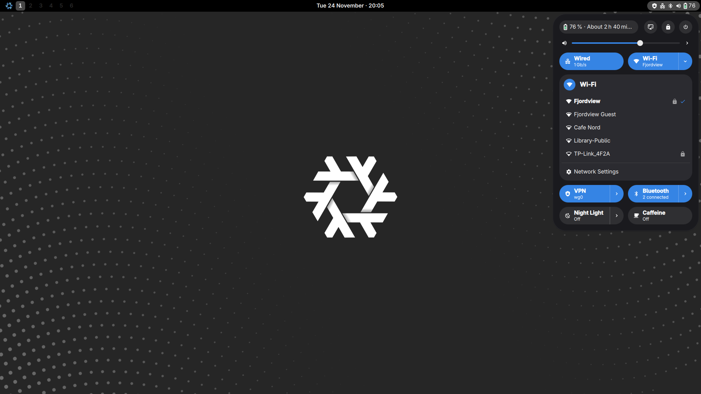 | 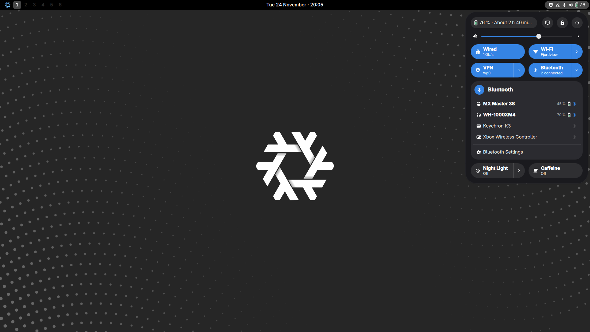 |
| Quick settings (SUPER+A), Wi-Fi | Quick settings, Bluetooth |
| 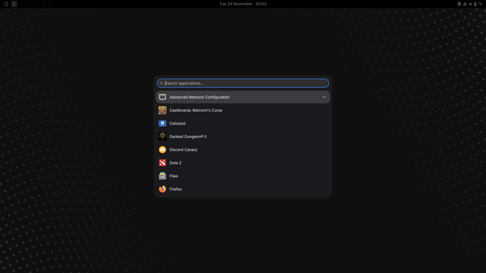 | 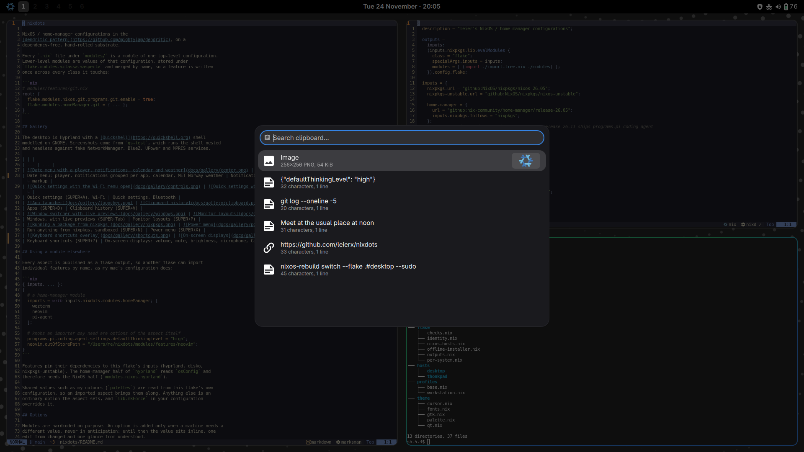 |
| Apps (SUPER+D) | Clipboard history (SUPER+V) |
| 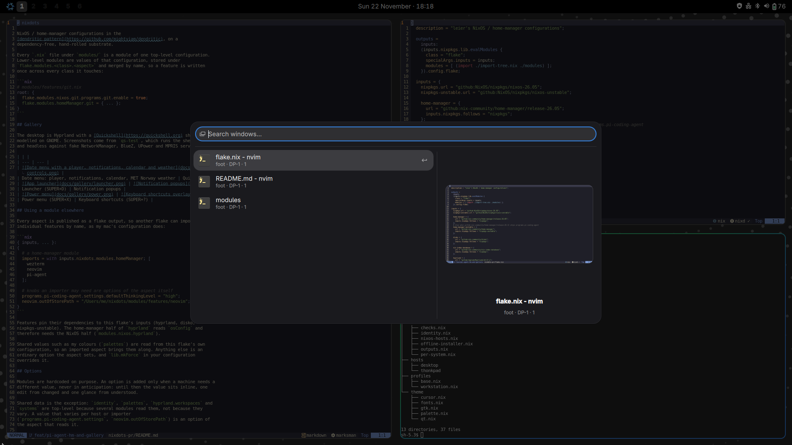 | 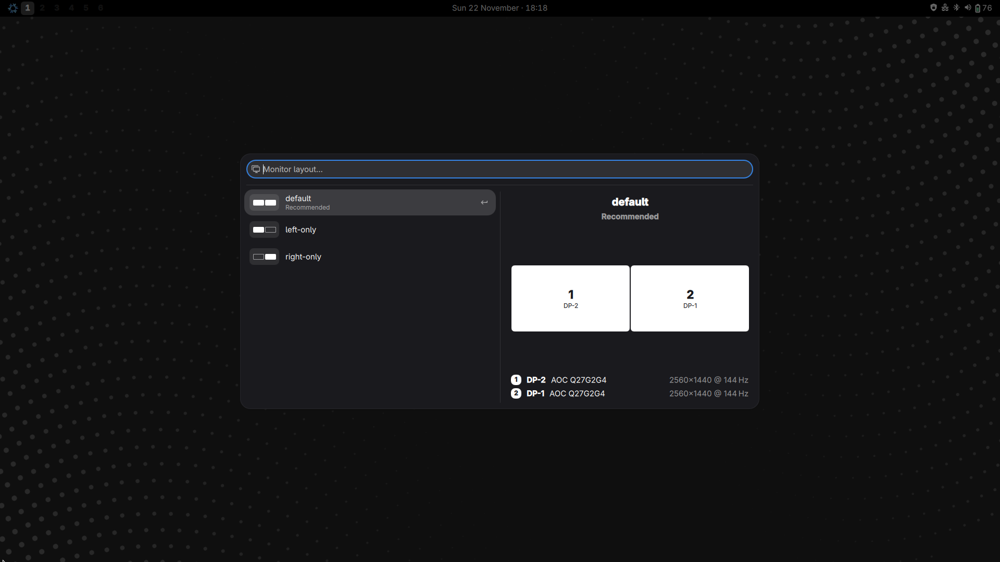 |
| Windows, with live previews (SUPER+Tab) | Monitor layouts (SUPER+P) |
| 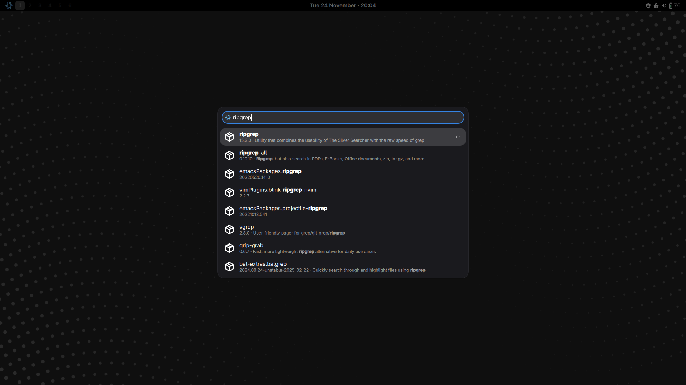 | 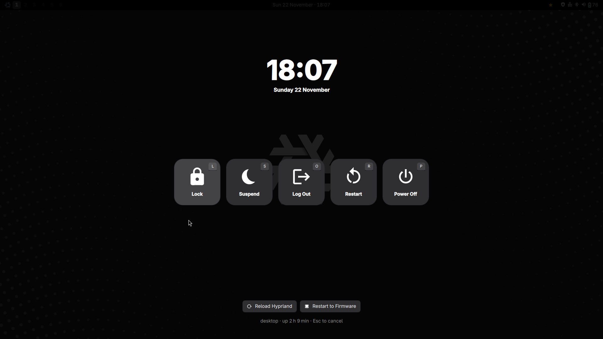 |
| Run anything from nixpkgs, sandboxed (SUPER+N) | Power menu (SUPER+X) |
| 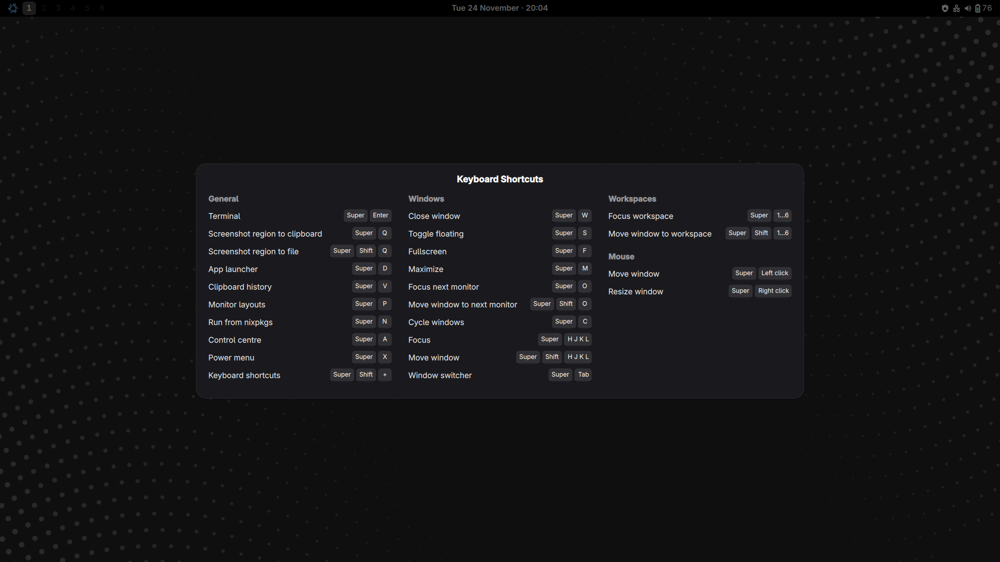 | 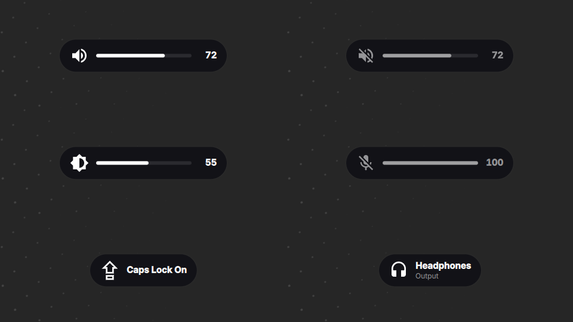 |
| Keyboard shortcuts (SUPER+?) | On-screen displays: volume, mute, brightness, microphone, Caps Lock, output |

## Using a module elsewhere

Every aspect is published as a flake output, so another flake can import
individual features by name, as my mac's configuration does:

```nix
{ inputs, ... }:
{
  # a home-manager module
  imports = with inputs.nixdots.modules.homeManager; [
    wezterm
    neovim
    pi-agent
  ];

  # knobs an importer may need are options of the aspect itself
  programs.pi-coding-agent.settings.defaultThinkingLevel = "high";
  neovim.outOfStorePath = "/Users/me/nixdots/modules/features/neovim";
}
```

Features pin their dependencies to this flake's inputs (hyprland, disko,
nixpkgs-unstable). The home-manager half of `hyprland` reads `osConfig` and
therefore needs the NixOS half (`modules.nixos.hyprland`).

Shared values such as my colours (`palettes`) are read from this flake's own
configuration, so an imported aspect brings them along. Anything else is an
ordinary option the aspect sets, and `lib.mkForce` in your configuration
overrides it.

## Options

Modules are hardcoded on purpose. An option is added only when a machine needs a
different value, never in anticipation: until then the value sits inline, one
edit from changed and one glance from understood.

Shared data is the exception: `identity`, `palettes`, `hyprland.workspaces` and
`systems` are top-level because several modules read them, not because they
vary. A value that varies per host or importer
(`programs.pi-coding-agent.settings`, `neovim.outOfStorePath`) is an option of
the aspect that reads it.

## Building

```bash
host=thonkpad

nixos-rebuild switch --flake ".#$host" --sudo
nix build ".#nixosConfigurations.$host.config.system.build.toplevel"

# offline installer ISO carrying that host's toplevel and disko script
nix build ".#nixosConfigurations.offlineInstaller-$host.config.system.build.isoImage"

nix flake check # formatting + evaluation of every host
nix fmt # nixfmt-tree
```

## Layout

```
flake.nix          evaluates modules/ and returns config.flake
import-tree.nix    imports every .nix file under a directory

modules/
  flake/           the substrate: output surface, perSystem, host builders,
                   identity, checks, offline installer
  features/        one flat file per feature, covering every class it
                   applies to; a directory only when the feature has parts
                   (hyprland/, moonshine/, neovim/, pi-agent/, tmux/)
  profiles/        base and workstation: named groups of features
  theme/           palette, fonts, gtk, qt, cursor
  hosts/           one directory per machine
```

Technical notes for agents live in [AGENTS.md](./AGENTS.md).
